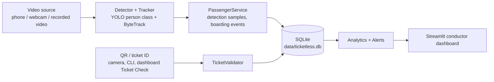

# AI Ticketless Passenger Detection

An AI-assisted bus passenger monitoring system for a conductor. A camera at the door (Android phone, webcam, or a recorded video) is processed with YOLO person detection and ByteTrack tracking. A person who crosses the entry line becomes a boarding event, tickets are validated by QR code or ticket ID against a SQLite database, and a Streamlit dashboard shows seven metrics, alerts and recent events.

**Principle: verification required, never "ticketless".** A boarding starts as `Ticket verification required`. The system never labels a person as travelling without a ticket because no ticket was seen. A missing QR code only means the conductor should check the ticket. A failed check (Invalid, Expired, Wrong route, Already used) is the result of a database lookup, and the conductor decides what happens next. No names, faces, images or contact details are stored. A Track ID is an anonymous number that only lasts for one detection session.

Detection and tracking are not perfect. See [docs/limitations.md](docs/limitations.md) for the known failure modes and the method to measure accuracy on your own labelled videos. This project does not claim any accuracy figure.

## Architecture



Data flow:

1. `app.main` opens the configured video source and runs one `YOLO.track` call per frame (person class only, ByteTrack IDs).
2. Each tracked person is stored as a throttled detection sample (first sighting, then at most one per `detection.record_interval_sec`).
3. A Track ID that crosses the entry line in the boarding direction, after being seen in at least `boarding.min_frames_seen` frames, becomes one boarding event (at most one per Track ID per session) with status `VERIFICATION_REQUIRED`.
4. A QR code seen in the camera frame is validated only when it can be linked to a boarded Track ID. The conductor can also check tickets on the dashboard's Ticket Check page or with `scripts/validate_qr.py`.
5. Every check goes through `app/ticket_validator.py` and is recorded in `validation_events`. The boarding's status is updated.
6. The dashboard reads the same database read-only and refreshes every `dashboard.refresh_sec` seconds. Only the Ticket Check form writes.

Module details, the schema and every rule are in [docs/architecture.md](docs/architecture.md).

## Installation

Requirements: Windows 10/11 and Python 3.11. No GPU is needed; inference runs on the CPU by default.

```bat
scripts\setup_windows.bat
```

The script finds Python 3.11 (`py -3.11` or `python`), creates `.venv`, installs the pinned `requirements.txt`, runs `pip check`, creates the database tables (`scripts\init_db.py`) and checks for `models\yolov8n.pt`. If the model is missing it prints the download command (see [models/README.md](models/README.md)):

```bat
cd models
..\.venv\Scripts\python.exe -c "from ultralytics import YOLO; YOLO('yolov8n.pt')"
```

Manual steps, CPU-only PyTorch and pin notes: [docs/installation.md](docs/installation.md).

## Video sources

Choose the source with `--source phone|webcam|video`, `camera.source_type` in `config/config.yaml`, or `TPD_SOURCE` in `.env`. Command-line flags win over the environment, which wins over the YAML. All three sources use the same `app/video_source.py`. The source is checked before processing starts, and errors say what to fix. Press `q` in the video window to stop (Ctrl+C with `--no-display`).

### Android phone camera (default)

1. Install an IP camera app on the phone, for example "IP Webcam", and start its server.
2. Connect the phone and the computer to the same Wi-Fi network or phone hotspot. The computer must be able to reach the phone's IP address.
3. The default URL is `http://192.0.0.4:8080/video`. Use the `/video` stream path. Open the URL in a browser on the computer to confirm it works.
4. Start detection:

```bat
scripts\run_detection.bat --source phone
scripts\run_detection.bat --source phone --url http://192.168.1.20:8080/video
```

To change the URL without editing code, use `--url`, `TPD_PHONE_URL` in `.env`, or `camera.phone.url`. The streaming app must stay running while detection runs. If the phone can't be reached, the run stops with exit code 2 and a checklist. `--fallback-webcam` (or `camera.fallback_to_webcam: true`) switches to the webcam instead; it is off by default so camera problems stay visible.

### Webcam

```bat
scripts\run_detection.bat --source webcam
scripts\run_detection.bat --source webcam --camera-index 1
```

Index 0 is the default (`camera.webcam.index`, `TPD_CAMERA_INDEX`).

### Recorded video

```bat
scripts\run_detection.bat --source video --path data\videos\bus_video.mp4
scripts\run_detection.bat --source video --choose-file
```

Allowed extensions are `.mp4`, `.avi`, `.mov`, `.mkv` (`camera.video.allowed_extensions`). The extension and the file's existence are checked before the model loads, so a wrong path fails within a second. `--choose-file` opens a file dialog filtered to those extensions. Recorded video never needs a live camera. Records are timestamped with the wall clock, not the video's own time.

### Other detection options

| Option | Purpose |
|---|---|
| `--station NAME` / `--trip-id ID` | Current station and trip for this run (station must be on the route) |
| `--model PATH` / `--conf 0.35` / `--device cpu\|auto\|cuda:N` | Detector settings |
| `--db PATH` | Database file (default `data/ticketless.db`) |
| `--no-qr` | Don't scan QR codes in camera frames |
| `--no-display` | No OpenCV window |
| `--max-frames N` | Stop after N frames |
| `--export-mot PATH` | Write MOTChallenge-style tracks for evaluation |
| `--log-level LEVEL` | DEBUG, INFO, WARNING or ERROR |
| `--config PATH` | Another config YAML |

`run_detection.bat` passes all arguments to `python -m app.main`. Legacy aliases `--phone-url`, `--webcam-index` and `--video` still work.

## Database

One SQLite file, `data/ticketless.db`, is shared by detection, ticket checks, the dashboard and the demo data. The path rule is `--db` > `TPD_DB_PATH` > `database.path` > `data/ticketless.db`; relative paths are resolved against the project root. Tables are created automatically on first start, or with `python scripts\init_db.py`.

| Table | Contents |
|---|---|
| `system_settings` | Schema version and creation time |
| `passengers` | Pseudonymous passenger references only (for example `PSG-1A2B3C4D5E`) |
| `tickets` | Ticket ID, passenger ref, route, boarding and destination station, travel date, validity window, status (ACTIVE/USED/CANCELLED), sha256 of the QR token |
| `detection_sessions` | One row per detection run: source, status, heartbeat, station, trip |
| `detection_records` | Throttled person-detection samples: Track ID, frame, time, confidence, box |
| `boarding_events` | One row per boarded Track ID per session, with its verification status |
| `validation_events` | Every ticket check: outcome, reason, channel, linked ticket and boarding |

Timestamps are stored as ISO-8601 UTC (`YYYY-MM-DDTHH:MM:SS.ffffffZ`). All SQL is parameterized. Status changes run in `BEGIN IMMEDIATE` transactions, so two checks of the same ticket can't both succeed. The database uses WAL mode, so detection and the dashboard can run at the same time.

`data/passengers.db` is a legacy file from the previous version. Nothing reads or writes it any more, and you can delete it yourself.

## QR ticket workflow

1. Issue a ticket and its QR image:

   ```bat
   .venv\Scripts\python.exe scripts\generate_qr.py --boarding "Central Bus Stand" --destination "Airport"
   ```

   Options: `--travel-date YYYY-MM-DD` (default today), `--valid-hours 12`, `--passenger-ref ID` (a pseudonymous ID, not a name), `--out data\qr_codes`, `--show-token`. The PNG is written to `data\qr_codes\<ticket_id>.png`.
2. Print it or show it on a phone. The QR holds only `TPD1:<random token>`. The database stores only the token's sha256, and passenger details are never read from the QR.
3. Check it:
   - camera: hold the QR inside the boarded passenger's box in the camera view;
   - dashboard: Ticket Check page (upload the image, enter the token, or type the ticket ID);
   - command line:

     ```bat
     .venv\Scripts\python.exe scripts\validate_qr.py --image data\qr_codes\TKT-1A2B3C4D.png
     .venv\Scripts\python.exe scripts\validate_qr.py --ticket-id TKT-1A2B3C4D --station "City Hospital"
     ```

     Other options: `--token T`, `--boarding-id N`, `--trip-id T`, `--db PATH`.
4. To re-print a QR, rotate its token: `scripts\generate_qr.py --ticket-id TKT-1A2B3C4D --rotate`. Earlier QR images of that ticket stop validating.

Outcomes: `VALID`, `INVALID`, `EXPIRED`, `WRONG_ROUTE`, `ALREADY_USED`, `VERIFICATION_REQUIRED`. The route, station order and current station come from `route` and `journey` in `config/config.yaml`. A passenger travelling past an intermediate stop toward a later destination on the ticket stays `VALID`. Expiry depends only on the ticket's validity window, never on station position. Full rules: [docs/architecture.md](docs/architecture.md#ticket-validation-rules).

## Conductor dashboard

```bat
scripts\run_dashboard.bat
```

Open http://127.0.0.1:8501. The dashboard reads the same database as detection (the sidebar shows its path). It has a period filter (Today, Yesterday, Last 7 days, All time, Custom range) and a validation-status filter that applies to the tables only.

**Security:** the dashboard has no authentication. `run_dashboard.bat` binds it to `127.0.0.1`, so only this computer can open it. The Ticket Check page can write validation results. Don't expose it on a network without adding authentication.

The main page shows exactly seven metrics for the selected period:

| Metric | Definition |
|---|---|
| Valid | Distinct tickets with a VALID check. Repeat scans of one ticket count once. |
| Invalid | Distinct credentials whose check returned Invalid, Wrong route or Already used. Expired tickets are counted separately. |
| Total Passenger | Total Passenger = verified passengers (distinct passenger refs with a valid ticket) + boarded Track IDs not linked to a valid ticket (verification required or failed). |
| Total Detection | Recorded person-detection samples: the first sighting of each Track ID plus at most one sample per record interval. Not a head count. |
| Expired Tickets | Distinct tickets whose check failed because the ticket had expired. |
| Boarding Events | Entry-line crossings confirmed as boardings, at most one per Track ID per session. |
| Tracking IDs | Distinct Track IDs observed, counted per detection session. |

Below the metrics: detection source status (and a live preview frame while detection runs), verification alerts, recent boarding events and recent validation results. The **Ticket Check** page is where the conductor checks a ticket and resolves failed verifications. See [docs/user_guide.md](docs/user_guide.md).

## Demo data

```bat
.venv\Scripts\python.exe scripts\generate_dummy_data.py
```

This writes a synthetic, clearly flagged dataset into the same database: 2 detection sessions, 12 demo tickets (`DEMO-TKT-001`..`012`), boardings and validations covering every outcome, and demo QR images in `data\qr_codes\demo\`. It is anchored to today (`--date YYYY-MM-DD` to change it) and re-running it is a no-op. If demo data for another day is already there, the script writes nothing, prints that day and the `--reset --generate` command that moves it to the new day. `--reset` deletes only synthetic rows; `--reset --generate` refreshes them. `--no-qr-images` skips the PNGs. The demo needs the default route R1, outbound, with the default stations. The dashboard sidebar shows when synthetic rows are present.

## Tests

```bat
scripts\run_tests.bat
```

or `.venv\Scripts\python.exe -m pytest -q`. Tests run offline, with temporary databases, fake cameras and fake models. They don't need the YOLO weights or a camera, and they never touch `data\ticketless.db`.

## Troubleshooting

`app.main` (and `run_detection.bat`) exit codes:

| Code | Meaning | What to check |
|---|---|---|
| 0 | Finished or stopped by the user | |
| 1 | Configuration or usage error | The message names the key, for example `detection.confidence: ...`; station not on the route; no file chosen |
| 2 | Video source error | Phone not reachable, webcam busy or missing, video file missing, wrong extension or unreadable |
| 3 | Database error | Path, permissions, or a database created by a newer version |
| 4 | Model error | `models\yolov8n.pt` missing or unreadable; see models/README.md |
| 5 | Unexpected error | Full traceback in `logs\app.log` |

`scripts\validate_qr.py` exits 0 for VALID, 10 for any other outcome, 1 for usage errors (unreadable image, no QR found, unknown boarding, database busy) and 3 for other database errors. `init_db.py`, `generate_qr.py` and `generate_dummy_data.py` use 0, 1 and 3 the same way.

Common problems:

- "Unable to connect to Android phone camera": check the same-network requirement, that the streaming app is running, and the URL. Try the URL in a browser.
- "Video file not found" / "Unsupported video file type": check the path (relative paths start at the project root) and the extension.
- "YOLO model file not found": download the model (see above). The project never downloads it automatically during a run.
- Low FPS on the CPU: lower `detection.imgsz` (for example 480), or use `--device auto` with a CUDA build of PyTorch.
- Dashboard shows "Detection is not running": start `scripts\run_detection.bat`; the status uses the session heartbeat.
- Dashboard shows zeros: the period may be empty. Choose "All time", or run the demo data script.
- "Database busy, try again": another process held a lock for longer than `database.busy_timeout_ms`; repeat the check.

Logs: `logs\app.log` (detection) and `logs\dashboard.log`.

## Limitations

- Detection and tracking miss people and make mistakes in crowds, poor light, occlusion and motion blur.
- A Track ID can change after long occlusion, tracker failure, or when a person leaves and re-enters. A new ID can create a second boarding.
- Total Detection counts throttled samples, not people.
- QR codes are hard to read at a distance or under motion blur; a missing QR never fails a ticket.
- The dashboard has no authentication.

Full list and the evaluation method (precision, recall, ID switches, false detections): [docs/limitations.md](docs/limitations.md).

## Future work

- Dashboard authentication and conductor accounts
- Person re-identification to reduce ID switches after re-entry
- Station updates from the dashboard or GPS to a running detection process
- GPU deployment and larger models for higher-resolution cameras

## Project layout

```
app/            detection process and shared business logic (config, database, video source,
                detector, tracker, entry line, passenger service, QR, ticket validation,
                alerts, analytics, pipeline, overlay, main)
dashboard/      Streamlit dashboard (app.py, pages/1_Ticket_Check.py, components/)
config/         config.yaml, bytetrack.yaml
data/           runtime database, QR images and videos (all gitignored)
models/         YOLO weights (gitignored), README.md
scripts/        Windows .bat files, init_db, generate_qr, validate_qr, generate_dummy_data
tests/          pytest suite
docs/           architecture, installation, user guide, limitations
```
